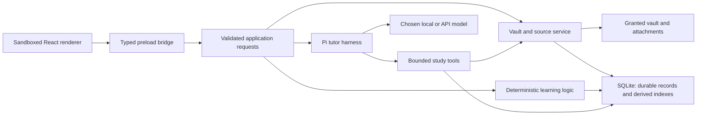

# Architecture and storage boundaries

Updated: 2026-10-04. The foundation follows confirmed user direction; the stack and contracts below are implemented experimental choices (`T01`–`T05`). See [implementation.md](implementation.md) for usage and limits.

Accepted v1 implementation: [v1-study-ecosystem.md](v1-study-ecosystem.md) proposes persistent entity IDs separated from paths/revisions; shared manual/model application services; contextual tutor state; explicitly reviewed app-owned Pi study skills/extensions; web discovery; faithful PDF/highlight anchors; and grouped note patches. The UI uses a bounded SVG graph; Pi Web Access 0.35.0 supplies the explicitly enabled Exa search backend. Automatic Pi resource discovery and general coding tools remain disabled. The 2026-10-04 refinement authorizes only vault-scoped create_note/edit_note writes through the shared backup/conflict/undo path. The current identity and expanded bounded tools are described below.

## Current stack

- Electron 44.5.1, TypeScript, electron-vite, React, and npm.
- Electron's built-in Node SQLite API; no external database process or native SQLite addon.
- Pi SDK `@earendil-works/pi-coding-agent` and `pi-ai` 1.0.1 embedded in the main process, with a custom tutor prompt, provider configuration, and study tools.
- `ts-fsrs` 5.4.2 for card scheduling.
- Patched PDF.js 6.4.299 for faithful page rendering and `unpdf` configured with that same engine for page-aware text extraction; Markdown parsing retains heading/line anchors.
- Local Ollama embeddings cached as Float32 vectors; lexical and vector results combined by reciprocal rank fusion. Retrieval is currently a linear scan, not an ANN index.
- Markdown rendering with GFM and KaTeX. Raw HTML is not enabled.

The old Python/Next.js architecture and hand-written scheduler were not copied. The user's separate personal Pi extension has not been supplied; this version extends upstream Pi through its SDK. Integrating that extension remains open.

## Process and module responsibilities

| Code | Responsibility |
| --- | --- |
| `src/shared/types.ts` | UI/main request, event, source, activity, and learning contracts |
| `src/main/application.ts` | Input validation, dialogs, settings, study actions, exports, and continuity |
| `src/main/store.ts` | SQLite metadata, durable records, document/chunk cache, and transactions |
| `src/main/vault.ts` | Granted file access, extraction, identities, indexing, embeddings, search, and reviewed tag writes |
| `src/main/learning.ts` | FSRS transitions, content versions, recall summaries, and ranking suggestions |
| `src/main/legacy-cards.ts` | Recognize the previous prototype's card definitions without trusting its scheduler state |
| `src/main/study.ts` | Shared scoped concept/edge/goal/guide/bit/proposal/practice services for UI and model tools |
| `src/main/note-writing.ts` | Shared direct-model and learner-reviewed note writes, containment, revision conflicts, metadata preservation, backups, recovery and undo |
| `src/main/study-prompts.ts`, `study-tools.ts` | Explicit tutor/role policies and bounded ecosystem operations |
| `src/main/web-search.ts`, `web-import.ts` | Search-only Pi backend and explicit source import with provenance |
| `src/main/pi.ts` | Pi runtime, credentials, model discovery, chat streaming, study tools, and feedback |
| `src/preload/index.ts` | Narrow request/event bridge; no raw filesystem or provider access |
| `src/renderer/src/` | Chat, sources, flashcards, exercises, concepts, and settings |

Activities have their own durable identities; there is no required study-session lifecycle. Pi JSONL sessions preserve tool conversation context, and SQLite holds the visible chats and study records. Provider-specific behavior does not compute schedules or authorize vault writes.

## Authority and recovery

| Data | Current authority | Recovery / portability |
| --- | --- | --- |
| Vault knowledge and learner-approved rank tags | Original Markdown folder | Ordinary files remain externally editable; reviewed tag writes create backups |
| Source originals | Vault files; attached originals copied into app data | Retained independently of extracted text; back up these files separately |
| Parsed documents, chunks, embeddings | Derived SQLite tables | Reindexable; rebuilding does not remove durable learning history |
| Chats, concepts, cards, exercises, attempts, help, reviews, rank events | Durable SQLite records | Full JSON export; card/exercise Markdown export; restore/import UI still open |
| Pi conversation/tool history | App-data `sessions/` JSONL files | Included in full study export |
| Current scheduler state | Card record plus versioned immutable review events | Reviews retain before/after states, scheduler version/configuration, and content version |
| App provider keys | Electron `safeStorage` encrypted values, or memory if encryption is unavailable | Excluded from exports and renderer snapshots |

SQLite runs in WAL mode. The schema currently uses indexed documents/chunks and typed JSON records for durable entities, with schema version 1. It is a compact prototype persistence layer, not a final relational schema or migration framework.

Card definitions live in app records by default. CSV/pasted batch import uses the shared bounded parser in `src/shared/card-csv.ts` for renderer preview and independent main-process validation, then transactionally saves new FSRS cards with import provenance. Batch deletion suspends existing records; review rejects suspended cards, and undo preserves scheduler state and immutable events. Legacy Markdown card definitions can be imported; reviews do not rewrite embedded JSON in the vault. Editing content starts a new schedule while retaining old reviews. A JSON export preserves study records but is not a self-contained vault/resource backup.

## Source identity and retrieval

A vault namespace is derived from its resolved root. Durable noteIdentity UUID records separate a document from its title/path/revision. Existing concepts retain IDs. Portable `noctua-id` frontmatter, or a unique unchanged content fingerprint when an old path is absent, can reconcile a rename conservatively. Copies with the same marker do not merge live originals; explicit portable-ID replacements get a new identity. Whole-note/section identities retain their evidence. Unique section content fingerprints help reconcile heading changes; ambiguous splits/merges remain unresolved. Root-folder moves remain a distinct open migration problem.

Passage IDs still identify exact revision and line/file-page location. Snapshots in messages, cards, exercises, guides, concepts, graph edges, bits and highlights preserve historical text. Opening a source uses its stable document ID to find the latest path, while displaying any revision mismatch. Original page rendering does not claim that extracted text preserves figures/equations.

Debounced recursive watching, or periodic file-stat checks when unavailable, reindexes changed notes. Unchanged documents are skipped and identical passage text reuses cached vectors with its existing endpoint/model key. Explicit indexing retries unavailable embeddings; watcher retries occur on file changes, not an endless inference loop. Durable records and source snapshots survive cache replacement. Local-only embeddings retain visible lexical fallback and no API fallback. Retrieval remains a linear lexical/vector scan.

Attachments are scoped to the current chat; the connected vault is shared. Queries do not retrieve another chat's attachment cache. The tutor receives up to twelve initial passages with bounded text, and can request more through validated tools.

## Electron and Pi boundaries

The renderer uses `contextIsolation`, `sandbox`, disabled Node integration, a content security policy, denied navigation/new windows, and denied permission requests. IPC accepts only validated request shapes from the main window's top frame. The application validates file containment, rejects symlink traversal, and opens only granted originals. External links use a validated HTTP(S) action. Development allows Vite's exact hashed preamble; packaged scripts keep a strict CSP.

Pi loads no general coding tools, shell/filesystem tools, user extensions, skills, prompt files, or project instructions. The authorized note writes use app-owned study tools. Its active study tool list is checked explicitly:

- `search_vault`
- `read_source`
- `get_learning_state`
- `create_flashcards`
- `create_exercises`
- `save_concept`, `connect_concepts`, `save_study_goal`, `save_study_guide`
- `find_practice`, `capture_bit`, `read_note`, `create_note`, `edit_note`, `propose_note_change`, `remember_study`, `focus_study`
- `web_search` only when explicitly enabled (reviewed Exa backend, search results only)

Exercise checking uses a separate temporary Pi session with only `record_feedback`. Creation validates bounded fields, concept scope, and source IDs actually retrieved/read before storing anything. The normal chat has a tool-call cap and cancellation. This is an application-enforced boundary, not only a system prompt.

Rank selection, scheduling, vault changes, and credential management remain application actions. Pi cannot promote a concept. It can create or edit connected-vault Markdown notes through the explicitly authorized note tools, with model origin, revision checks, backups and undo. Retrieved content is data, never instructions. These choices use the [Pi SDK](https://github.com/earendil-works/pi/blob/main/packages/coding-agent/docs/sdk.md) and the host application's responsibility for boundaries described in [Pi's permissions guidance](https://github.com/earendil-works/pi#permissions--containerization).

## Models and credentials

The composer has a model picker. Local models come from a loopback OpenAI-compatible `/v1/models` endpoint or manual IDs. Tool-compatible chat uses `/v1/chat/completions`; the prototype assumes a 16,384-token local context and 4,096-token output budget. Ollama reasoning capabilities are discovered through bounded `/api/version` and `/api/show` reads, cached by endpoint/model, and mapped to exact supported SDK levels. Automatic context/image/tool capability discovery remains future work.

API models come from Pi's provider catalog. Choosing an API model sends the relevant conversation, retrieved passages, and tool results to that provider. Choosing a local model does not silently fall back to an API. Embeddings have a separate local-only setting.

Reusing `~/.pi/agent/auth.json` is opt-in. When enabled, Pi's credential store handles normal OAuth refresh with its file locking and can update that shared file. New keys entered in Noctua remain app-managed runtime overrides. Command-style credential values beginning with `!` are rejected. Noctua does not load the user's executable Pi extensions through this option.

## Writes and remaining boundaries

Concept rank writes require the learner to preview the complete before/after note. The main process checks the expected revision, creates an app-data backup, writes a sibling temporary file, rechecks for conflicts, and atomically replaces the original. Existing encoding/newline conventions and surrounding text are preserved where possible. Competing rank tags in frontmatter/target headings are reconciled without removing unrelated tags. Invalid frontmatter rejects the write. General note changes use the shared NoteEditor path. The learner can review grouped proposals; create_note/edit_note can save a single model change directly under the later 2026-10-04 authorization. The model cannot accept arbitrary queued proposals, change rank tags or note identity, or delete files. New-note placement uses an exclusive no-clobber commit; existing changes preflight and recheck revision, keep backups and support conditional grouped undo. The renderer remains a study workspace rather than an unrestricted filesystem editor.

Section placement uses the same Markdown anchors as retrieval, ignoring fenced examples/frontmatter. Accepted passages are linked to selected concepts with actual cached source snapshots; file-batch undo removes only the links created by that placement. These associations establish provenance, not assessment. Application shutdown blocks new requests, cancels model work and waits for in-flight writes/indexing before closing SQLite.

PDF rendering preserves original page appearance; extraction supplies text/file pages and still has no OCR, verified equation reconstruction or model figure interpretation. Saved highlights carry page-normalized rectangles, quotation and revision; older highlights remain historical rather than being painted over changed pages. The original remains available. Noctua must expose these limits rather than claim faithful textbook scanning. Performance on large vaults, multi-window coordination, signed distribution, and robust migrations remain future work.

PDF page identity becomes selectable only after the matching source revision, page image and text layer have finished rendering. Navigation/zoom/source transitions hide the previous surface rather than relabel its selectable text as the next page. Native checks assert actual page-two text after a page transition.

## Source reading and composition (2026-10-03)

The renderer uses CodeMirror state for raw composer text and in-place Markdown decorations/math widgets without rewriting the source. CodeMirror owns cursor, selection, composition, and undo history; formatting no longer uses a separate preview. `source-reading.ts` performs bounded current-document reads separately from cached retrieval passages. The sourceDocument action resolves the source ID in trusted backend records, verifies granted containment, and returns current text/revision alongside the saved citation. Failures keep historical evidence available.

The sourceAsset action allows only bounded local raster images within the connected vault and rejects symlink traversal and external schemes. sourceLink resolves only indexed same-vault notes/headings and rejects ambiguous targets. The full reader has independent scrolling; reopening the desk restores mounted activity state. Markdown renders without raw HTML execution. Open-original constructs only Obsidian open URIs from trusted vault paths; generic external-link IPC still permits HTTP(S) only. Attachments retain the system viewer. These paths do not enable vault writes or broader model tools.

## Provider discovery and composer commands — 2026-10-03

Pi receives per-session reasoning effort constrained to its model capability mapping. Network catalog refreshes run only for providers with configured authentication, with an eight-second cancellation boundary; SDK model metadata is cached in app-owned SQLite metadata separately from credentials. Local model discovery continues through the granted loopback endpoint. Catalog cache updates are not inference and never trigger local-to-API fallback. Runtime configuration serializes refreshes; sending/checking waits for a pending configuration. No automatic extensions or user model configuration files are loaded.

CodeMirror supplies cursor-local `/` and `@` menus outside code spans/blocks. Tool intent uses the existing validated activity field; vault mentions resolve trusted indexed passages through the document action. Rendering chips does not alter the Markdown draft or add filesystem/model permissions. Generic external-link validation remains HTTP(S) only.

## Provider login boundary — 2026-10-03

`provider-login.ts` implements status/prompt orchestration and an encrypted app CredentialStore; Pi owns OAuth/PKCE, callback validation, token exchange, and refresh. Store mutations serialize login, refresh, and deletion, and unavailable OS encryption leaves process-local credentials. The main process exposes only status, the authorization URL, and a redirect-input prompt to the renderer. Validated IPC supports start/reply/cancel/disconnect, and only SDK-originated HTTPS auth.openai.com URLs are opened automatically. Pending login blocks model sends/checks and settings changes; background discovery does not replace a login’s runtime. Shutdown awaits cancellation before closing SQLite. Opt-in shared Pi credentials retain the SDK’s locked file store instead.

## Tab context boundary — 2026-10-03

Conversation records optionally have `parentId` identifying their root conversation and `closed` for reversible closure of tabs containing work. Empty closed tabs are discarded from memory and SQLite. If the empty first tab groups siblings, a remaining tab becomes the root transactionally; sibling IDs, histories and source scopes stay intact. Startup removes legacy empty closed entries, including renamed placeholders. Each tab continues to use its own Pi JSONL session and SQLite message history. Automatic attachment retrieval stays scoped to the active tab; explicit selection transfer can cross sibling tabs. Whole-conversation deletion removes all grouped visible histories, preserving learning artifacts as before.

`chat-context.ts` resolves explicit excerpt origins against granted vault/sibling attachment scopes or accessible study activities. `addChatReference` persists a trusted origin/label snapshot as a durable `chatReference` record before queueing the chip. Sending resolves saved reference IDs for that exact destination tab; caller replacements cannot alter the saved quote. Messages retain reference snapshots and exports include reference records. Indexed source IDs describe the origin document/passage, not proof that rendered selected text occurs in the original cached passage. The tutor receives selected excerpts as untrusted data, distinguished from learner answers and indexed source grounding.

Renderer-local tab workspace state retains drafts, chips, current source, tool intent, and desk choice across switching/restarts; review/reveal and exercise selections are keyed by tab. Closing includes the current local draft flag and clears discarded tabs’ local workspace state. Durable exercise help/answers remain in SQLite. Renderer preferences/drafts are not part of the full-study export yet. A shared selection wrapper captures mouse/keyboard selections in saved main-chat message text, card fronts/revealed backs, exercise prompts, and Markdown/PDF readers, then offers a floating direct-destination toolbar (the original dialog was superseded on 2026-10-04). No model request or vault write occurs on selection.

Chat selections identify a saved message by `messageId`. The backend verifies sibling-tab access and derives its original role, conversation identity, label, bounded nearby Markdown and available source snapshots from storage. Saved reference IDs resolve the immutable quote/context for the exact destination tab, just like source selections. The model receives this as a quotation of a previous user/assistant message; it is not a new learner answer or an authoritative source. Live responses become selectable after their text is saved on completion, stop or error.

## Selection context expansion — 2026-10-04

`SelectionToChat` uses a body portal with fixed positioning measured from the visible selection rect. Numbered destination buttons directly call `addChatReference`; the modal destination chooser is removed. The toolbar clamps to the viewport, tracks scroll/resize and supports Escape. Review hotkeys pause during a text selection. Stable rendered block components expose source line hints and preserve selected DOM during refreshes.

Before storing an excerpt, the main process resolves its authorized origin and obtains bounded current source text through the existing containment checks. Current text is eligible only at the displayed revision; matching indexed passages relocate the source pointer when available. Source context captures original text, heading, line/page boundaries, revision, and a fallback note rather than silently mixing source versions. Stored reference IDs continue to resolve immutable snapshots for that exact destination tab. Activity context comes from trusted saved prompts/card content, excluding exercise solutions/hints and unrevealed card answers. Context and origin source IDs are sent separately from the exact selection; full source snapshots are omitted from prompt metadata to avoid duplicating their text.

Explicitly transferred source IDs are registered in the session’s allowed source map. The existing `read_source` tool has optional `surrounding`; it returns the origin passage and up to two adjacent chunks of the same file/revision, registering only those returned neighbors as available citations. An explicitly shared sibling file can be explored through its returned IDs; automatic retrieval still uses the active tab’s scope, and unrelated sibling files cannot be opened. Historical snapshots expose unavailable matching indexed revisions rather than substituting a newer file.

## Local reasoning capability discovery — 2026-10-04

`local-reasoning.ts` reads Ollama's advertised thinking values rather than assuming all local models are non-reasoning. Cache only normalized effort maps/labels in derived metadata scoped by endpoint/model. Refresh on model scans, retain last known values if offline, and bound reads to four seconds, four concurrent requests, and 64 models per scan. No generation, model load, or shell tools are involved. Provider-neutral servers without metadata retain their default request behavior and the UI labels this “Server default”. Boolean controls expose a single “Thinking on” step; always-on models omit Off. Named steps map exactly, with explicit Off serialized as `reasoning_effort: none` through Pi's normal OpenAI-compatible adapter. Full model context/vision/tool capability discovery and native LM Studio reasoning control remain open.

## V1 context and role boundaries — 2026-10-04

Shared StudyService operations validate accessible scopes, source snapshots, graph endpoints and rubric facets. Manual graph actions can use explicitly visible attachments; a model gets only the current vault and its own chat attachments. Context is bounded and reports omitted coverage rather than implying a full-vault view. Imported ranks/notes remain self-reported material. Facet content versions prevent historical work from assessing a redefined meaning.

Organizer/evaluator selections are explicit settings and run with single-purpose tools; they cannot silently choose a remote fallback. Source text and search output are untrusted data. Pi Web Access is imported only for its reviewed Exa MCP function; automatic package/extension discovery and its download/browser/coding capabilities are disabled. Queries go to external search only when enabled. Explicit user imports validate public HTTPS redirects, response type/size and provenance; originals are stored in chat resources.

focus_study persists a bounded handoff and emits a UI focus event. Completion uses a Pi custom application message with no fabricated learner turn. It includes actual work/help and consumed card IDs; a durable resumedAt prevents duplicate successful returns. A failed continuation can be retried, and continuation sessions omit focus_study to prevent loops. Guided study and notes-on-study are independent chat preferences. Pending note patches and generated connections do not establish learning or authorize vault writes.

## Learner profile and temporary chats — 2026-10-04

Store keeps newly opened, untouched conversation records in memory; meaningful records promote their conversation and required parent to durable SQLite records. Empty renderer drafts are released conservatively, and temporary records are omitted from study exports. Existing placeholder cleanup checks associated durable work before releasing a record. Transaction rollback restores the temporary-record map along with SQLite state.

Optional profile text/photo lives in app settings. The shared Pi session factory appends bounded learner profile/preferences to the existing tutor/organizer/evaluator prompt; the photo is excluded. Profile text cannot authorize tools or vault writes. The renderer decodes and resizes selected raster photos; IPC validates size, base64 and image signatures and rejects remote/SVG image values. No profile file path is exposed to the model.

## Model defaults and independent chat naming — 2026-10-04

Providers owns connection configuration; Models edits the existing `modelKey` and `roleModels` plus the new `chatTitle` role. No per-model activation state exists. Both menus use shared provider-aware GPT deduplication while retaining the GPT-5.6+ policy. Unavailable saved choices remain explicit and never silently cross providers.

After persisting the first user message, PiHarness starts one tool-free, bounded, in-memory naming session without taking the tutor busy lock. `titleOrigin` protects manual/question/model provenance; `titleGeneration` records selected model, request identity and status. Delayed results reread the current conversation and cannot overwrite manual names or recreate a deleted tab. This work contributes no messages, JSONL tutor turns or learner evidence. Stop cancels tutoring; reconfiguration/shutdown also cancel naming and settle its tracked jobs before storage closes. Startup marks interrupted names failed. Existing manually named chats are not renamed retroactively.

## Movable study tabs — 2026-10-07

Confirmed user direction: replace the always-visible Sources/Cards/Practice/Notes button row with ordinary tabs. A new right-pane tab shows a chooser; selecting an activity converts the tab. The main **+** opens the same chooser, including Chat. Activity tabs can be dragged between the right pane and the main tab strip beside chats, with keyboard-accessible move buttons as an alternative. The panes select activities independently. Closing an activity removes its tab without deleting study records; a right pane with no activities returns to a chooser. Moving the last right-pane activity into main hides the empty pane for more room. Existing chat and concept-map tabs stay in main. This supersedes the earlier fixed activity buttons and right-pane-only placement.

Implemented experimental choice: one tab per activity kind per chat, with pane placement, open tabs and selected activities saved in renderer preferences. Choosing an already-open activity focuses or moves that tab rather than creating a competing copy. Activity surfaces remain mounted and move through CSS grid placement, preserving editors, review state, PDF state and scroll positions. Their existing conversation IDs, attachment scopes and study operations are unchanged. Hidden card panels do not receive review hotkeys. Source reading has its own Sources tab, returning to the originating activity on close. Tutor handoffs open/focus their actual activity tab and retain the existing explicit completion/resume behavior. Saved layout preferences are cleared for discarded/deleted chat tabs and are not part of the study export. A duplicate-instance docking library was avoided to keep state ownership explicit; arbitrary duplicate activity instances and moving chat/map tabs remain outside this iteration.

## Message copy and reply forks — 2026-10-09

Confirmed user direction: copy Markdown from both learner messages and bot replies, and fork a bot reply into another chat. Saved message footers now expose **Copy Markdown**; assistant replies additionally expose **Fork to new chat**. Copy uses the saved raw Markdown rather than rendered text. Fork creates a sibling chat with the entire saved reply staged as a durable quotation, preserving its message identity, authorship and accessible source snapshots. It opens the destination for a follow-up without automatically sending anything. This is a message-centered fork, not a clone of the full conversation or its Pi session. It creates no learning evidence and duplicates no reviews or attempts.

The backend derives the reply from a trusted saved message ID and creates the chat/reference transactionally. Sending an already-persisted quote includes a bounded text placeholder in IPC; existing saved-reference resolution restores its complete immutable text. This avoids truncating long forked replies at the ordinary excerpt-input limit. Clipboard failures and fork errors remain visible. Validation: TypeScript and formatting checks; tests were not rerun under the user's earlier instruction.

Model discovery refinement (2026-10-14): with SDK `refreshOnCreate: false`, a fresh ModelRuntime has no configured-provider availability snapshot. After restoring credentials/runtime API keys, initialize cached models and authentication availability through `refresh({ allowNetwork: false })` before filtering providers for network discovery. This keeps saved subscriptions available during startup and focus/periodic scans without assuming authentication from a model name or changing the chosen provider.

LaTeX rendering refinement (2026-10-14): `latex-math.ts` registers a Micromark text construct and MDAST conversion for `\(…\)` / `\[…\]` alongside Remark Math's dollar syntax. Tokenization retains source offsets/line endings and LaTeX bodies for KaTeX without rewriting input or durable records. Code fences/spans use their existing Markdown tokenizers; escaped/incomplete delimiters fall back to ordinary Markdown.
